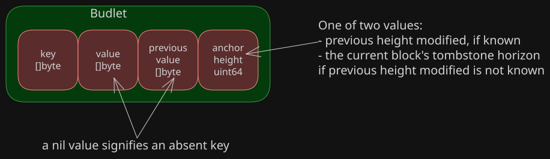
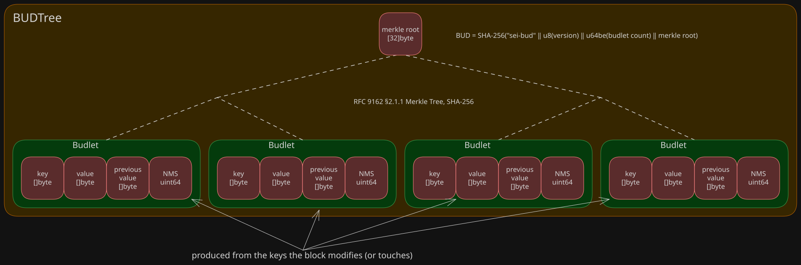
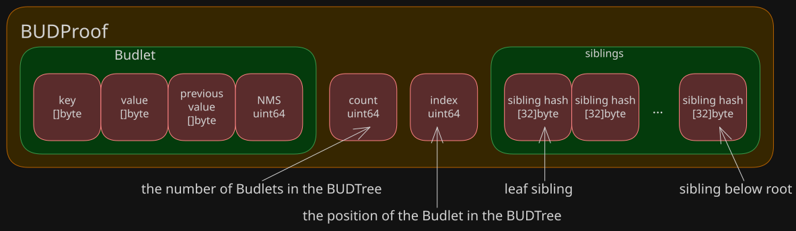
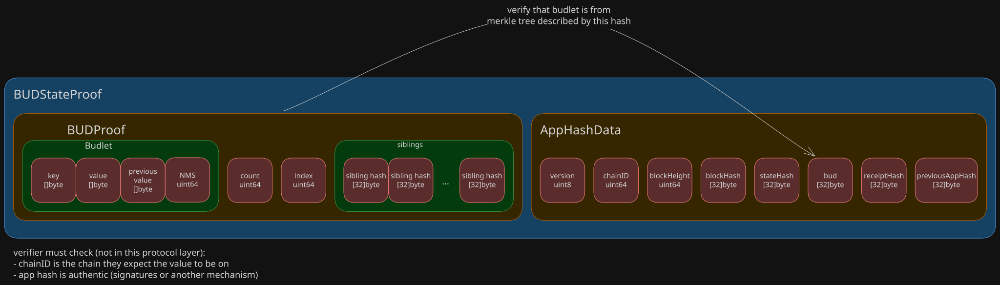

# Block Update Digest

**BUD version:** 1. **BUD proof version:** 1. **BUD state proof version:** 1.

This document defines the Block Update Digest (BUD), a family of formats that commit to the key-value writes a
block makes and prove them:

- the budlet, one key's write
- the BUD tree, the Merkle tree over a block's budlets
- the BUD hash, a 32-byte commitment to a BUD tree, which is the `budHash` field of the block's
  [app hash](../apphash_spec.md)
- the BUD proof, which proves that one write is among those a BUD hash commits to
- the BUD state proof, which pairs a BUD proof with its block's app hash data to prove a key's value over a range
  of heights

It does not define how a reader comes to trust an app hash.

## Notation

- `‖` is byte concatenation.
- `u8(x)` is `x` as a single byte.
- `u32be(x)` is `x` as a 4-byte unsigned big-endian integer.
- `u64be(x)` is `x` as an 8-byte unsigned big-endian integer.
- `SHA-256(x)` is FIPS 180-4 SHA-256, with a 32-byte output. `SHA-256` of the empty string is
  `e3b0c44298fc1c149afbf4c8996fb92427ae41e4649b934ca495991b7852b855`.
- A *hash* is exactly 32 bytes.
- Byte strings are ordered lexicographically by unsigned byte value, and a proper prefix orders before any
  string it is a prefix of.
- `⌊x / 2⌋` and `⌈x / 2⌉` are integer division rounded down and up.

## Terms

- **BUD:** Block Update Digest, the family of formats this document defines.
- **budlet:** the 4-tuple (`key`, `value`, `previousValue`, `notModifiedSince`) for one key a block modified.
- **BUD tree:** the Merkle tree whose leaves are one block's budlets.
- **BUD hash:** the hash committing to a BUD tree.
- **BUD proof:** a budlet together with the proof that it is a leaf of the BUD tree under a given BUD hash.
- **BUD state proof:** a BUD proof paired with its block's app hash data, proving the key's value over a range of
  heights.
- **payload:** the value the live state database holds for a key, beside the height of the block that last wrote
  it. A payload includes the serialization version of the value.
- **absent payload:** the payload a key's value type defines for a key that holds no value.
- **value at a height:** a key's value at height `h` is its payload in the state after executing the block at
  height `h`, or its absent payload if the state holds no entry for the key. The value at height 0 is the key's
  value in the genesis state.
- **not-modified-since height:** the inclusive lower bound of the heights at which a budlet proves that its key held
  the budlet's previous value. No block after it and before the budlet's block modified the key.
- **tombstone:** the entry a deletion leaves in the state: the key's absent payload, held with the height of the
  deletion.
- **tombstone horizon:** each block has its own tombstone horizon. For the block at height `C`, it is a height
  `T ≤ C − 1` such that the state is guaranteed to hold the tombstone of every deletion at height `T` or above;
  tombstones of deletions below `T` may have been removed. From one block to the next, the tombstone horizon may
  stay the same or move forward, but never moves backward.

## Budlets



### Purpose

Executing a block yields one budlet for each key it modified. A block's writes are a set: each key the block modifies
has one new value, which lands at the end of the block. A touch, a write of a key's existing value, is still a
modification, and a deletion is a write of the key's absent payload. A budlet records the key's new value, its
previous value, and a not-modified-since height. It can be used to prove that the key held its previous value over
[not-modified-since height, block height) and its new value at the block's height, so a BUD state proof can show the
key's value over a range of heights from a single block.

### Schema

**Version:** BUD version 1.

A budlet is a 4-tuple (`key`, `value`, `previousValue`, `notModifiedSince`). In this section, `C` is the height of the
block the budlet belongs to.

| Element            | Type                    | Meaning                                                      |
|--------------------|-------------------------|--------------------------------------------------------------|
| `key`              | byte string             | The key modified, as the live state database stores it.      |
| `value`            | byte string             | The payload the block wrote.                                 |
| `previousValue`    | byte string             | The payload held over [`notModifiedSince`, `C`).             |
| `notModifiedSince` | 64-bit unsigned integer | Inclusive lower bound of the heights `previousValue` covers. |

`key` is 1 to 2^32 − 1 bytes. `value` and `previousValue` are each 0 to 2^32 − 1 bytes.

#### Keys and values

Budlets describe writes to the live state database that [`stateHash`](../apphash_spec.md#statehash) commits to.

- A block has one budlet for each key it writes whose entry `stateHash` commits to. Entries `stateHash` excludes,
  such as the database's own metadata, have no budlets.
- `key` is the key as the live state database stores it, the key `stateHash` hashes. When several logical values
  share one key, a block that changes any of them has one budlet for that key.
- `value` and `previousValue` are payloads. How the database lays out a payload and its height is not defined by
  this document.
- A deletion writes the key's absent payload, which the key's value type defines. A budlet has no other
  representation of a deleted or absent key.

#### Not-modified-since height

A budlet guarantees that its key held `previousValue` at every height from `notModifiedSince` through `C − 1`. It does
not assert that the key was written at `notModifiedSince`.

`notModifiedSince` is determined by the key's entry in the state at height `C − 1`:

- If the state holds an entry for the key, either a value or a tombstone, `notModifiedSince` is the height the
  database holds with it, which is the height of the block that wrote it, and `previousValue` is its payload.
- Otherwise, `notModifiedSince` is `T`, the tombstone horizon of the block at height `C`, and `previousValue` is
  the key's absent payload.

When the state holds no entry for the key, any deletion that removed it was at a height below `T`, so the key was
absent at every height from `T` through `C − 1`. `T` is defined by the state, not by this document, and is carried
in no format this document defines.

Since `T ≤ C − 1`, `notModifiedSince` is always below `C`. A budlet does not hold `C`; a BUD state proof checks the
bound.

#### Serialization

`serialize(b)` is the fields below, in order, with no padding or separators. The serialization is also the input
to the budlet's leaf hash.

|                 Size | Field                 | Encoding                    |
|---------------------:|-----------------------|-----------------------------|
|                    4 | key length            | `u32be(len(key))`           |
|           `len(key)` | `key`                 | raw bytes                   |
|                    4 | value length          | `u32be(len(value))`         |
|         `len(value)` | `value`               | raw bytes                   |
|                    4 | previous value length | `u32be(len(previousValue))` |
| `len(previousValue)` | `previousValue`       | raw bytes                   |
|                    8 | `notModifiedSince`    | `u64be(notModifiedSince)`   |

This is Solidity's

```
abi.encodePacked(uint32(key.length), key, uint32(value.length), value,
                 uint32(previousValue.length), previousValue, uint64(notModifiedSince))
```

The serialization carries no version of its own. It is defined by the BUD version of the BUD tree or BUD proof
that the budlet travels with.

### Verification

An implementation rejects, as an error, a budlet that does not follow the schema above.

A decoder rejects, as an error:

- input that ends before the end of a field
- a key length of 0

### Test vector

The test vectors in this document use one block, at height 9, of three budlets. Their keys and payloads are
illustrative: the vectors exercise the BUD encoding, not the semantics of any value type.

| `b[i]` | `key` (ASCII) | `key` (hex)  | `value`  | `previousValue` | `notModifiedSince` |
|-------:|---------------|--------------|----------|-----------------|--------------------|
|      0 | `evm/a`       | `65766d2f61` | `00aabb` | `00aa`          | `0`                |
|      1 | `evm/b`       | `65766d2f62` | `00bbcc` | `00bb`          | `7`                |
|      2 | `evm/c`       | `65766d2f63` | `00cc`   | empty           | `8`                |

Their serializations, one column per field, in hex, split across two tables.

| `b[i]` | key length | `key`        | value length | `value`  |
|-------:|------------|--------------|--------------|----------|
|      0 | `00000005` | `65766d2f61` | `00000003`   | `00aabb` |
|      1 | `00000005` | `65766d2f62` | `00000003`   | `00bbcc` |
|      2 | `00000005` | `65766d2f63` | `00000002`   | `00cc`   |

| `b[i]` | previous value length | `previousValue` | `notModifiedSince` |
|-------:|-----------------------|-----------------|--------------------|
|      0 | `00000002`            | `00aa`          | `0000000000000000` |
|      1 | `00000002`            | `00bb`          | `0000000000000007` |
|      2 | `00000000`            |                 | `0000000000000008` |

`serialize(b[i])` in later test vectors stands for the bytes of row `i` of the first table followed by row `i` of
the second.

Verified by [`TestBUDSpecVector`](bud_spec_vector_test.go).

## BUD tree



### Purpose

A block's budlets, arranged as a Merkle tree. Whoever holds a block's BUD tree can build a BUD proof for any of its
budlets, and the tree's root determines the block's BUD hash.

### Schema

**Version:** BUD version 1.

A block's budlets hold one budlet per key the block modified, in strictly increasing key order.

The hashes of BUD tree nodes are

```
leafHash(b)            = SHA-256(u8(0x00) ‖ serialize(b))
innerHash(left, right) = SHA-256(u8(0x01) ‖ left ‖ right)
```

The leading byte separates leaves from inner nodes, so that no leaf can be presented as an inner node or the
reverse.

The root `R` of the BUD tree over a block's `n` budlets `b[0] … b[n−1]` is computed level by level:

1. If `n = 0`, `R` is `SHA-256` of the empty string.
2. Level 0 is `leafHash(b[0]) … leafHash(b[n−1])`.
3. The level above a level of `s > 1` nodes is formed by replacing each pair at positions `(0, 1)`, `(2, 3)`,
   … with `innerHash` of the pair, in order. When `s` is odd, the last node has no pair and is carried up to
   the level above unchanged: it is neither hashed nor duplicated. The level above has `⌈s / 2⌉` nodes.
4. Repeat step 3 until a level has one node. That node is `R`.

When `n = 1`, `R` is the single leaf hash.

*Non-normative:* this is the Merkle Tree Hash of
[RFC 9162 §2.1.1](https://www.rfc-editor.org/rfc/rfc9162#section-2.1.1)
([RFC 6962 §2.1](https://www.rfc-editor.org/rfc/rfc6962#section-2.1)), with `leafHash` and `innerHash` as its leaf
and node hashes.

*Non-normative:* [BUD tree shapes](bud_tree_shapes.md) shows how to draw the tree for a given `n`.

### Verification

An implementation rejects, as an error, budlets that are not strictly increasing by key.

### Test vector

The BUD tree over the three budlets of the Budlets test vector. Its leaf hashes are:

```
L0 = leafHash(b[0]) = 0473228ae7de8d729da1c3829911e44bd8132bb70231601c81284c479194dd60
L1 = leafHash(b[1]) = e40d5c36c1f33b62926219ab8f643dcb540b86ea6af98731027109764392804c
L2 = leafHash(b[2]) = 905f946a6e3487f06c7b1b525d651e8ee7a48fa5fbe481e50a40d09e79939d7e
```

Level 0 is `L0 L1 L2`. Level 1 is `N = innerHash(L0, L1)` followed by `L2`, carried up unpaired. Level 2 is
the root.

```
N = innerHash(L0, L1) = 329d1fc527f7bc747989903c7a8dc0778cec41b98a695acab12887c02f157b25
R = innerHash(N, L2)  = bc19858156c6b699dd78dd68213e06fbf347d30a6c5596cb3686902775148282
```

A block with no budlets has a root `R` of `SHA-256` of the empty string.

Verified by [`TestBUDSpecVector`](bud_spec_vector_test.go) and
[`TestBUDSpecEmptyTreeVector`](bud_spec_vector_test.go).

## BUD hash

### Purpose

A single hash that commits to every write a block made. It is the `budHash` field of the block's app hash data, so
anyone who trusts a block's app hash can check BUD proofs against it.

### Schema

**Version:** BUD version 1.

```
budHash = SHA-256("sei-bud" ‖ u8(version) ‖ u64be(n) ‖ R)
```

| Size | Field     | Value                                                                             |
|-----:|-----------|-----------------------------------------------------------------------------------|
|    7 | domain    | the ASCII bytes `sei-bud` (`7365692d627564`), with no terminator or length prefix |
|    1 | `version` | `1`, the BUD version this document defines                                        |
|    8 | `n`       | `u64be` of the number of budlets                                                  |
|   32 | `R`       | the BUD tree root                                                                 |

The domain separates a BUD hash from every BUD tree node, whose preimages begin with `0x00` or `0x01`, and from
objects of other kinds that commit to a tree of this shape, which use other domains. The BUD hash commits to `n`
so that a BUD proof cannot claim a different `count` and `index` for the same root.

### Test vector

The BUD hash of the BUD tree test vector is `SHA-256` of:

| Field     | Bytes (hex)                                                        |
|-----------|--------------------------------------------------------------------|
| domain    | `7365692d627564`                                                   |
| `version` | `01`                                                               |
| `n`       | `0000000000000003`                                                 |
| `R`       | `bc19858156c6b699dd78dd68213e06fbf347d30a6c5596cb3686902775148282` |

which is

```
4f3428944c0a960bb22d615446c3badd7790eaa96a2dd4519c14abc1c48cf086
```

The BUD hash of a block with no budlets, with `n` = 0 and `R` `SHA-256` of the empty string, is

```
9725d028d186ff14d54a60658eac9ea435e5bace76d9aa01df155e4e89f1678f
```

Verified by [`TestBUDSpecVector`](bud_spec_vector_test.go) and
[`TestBUDSpecEmptyTreeVector`](bud_spec_vector_test.go).

## BUD proof



### Purpose

Given a block's BUD hash, a BUD proof proves two facts about one key:

- the block wrote `value` to the key
- the key held `previousValue` at every height from `notModifiedSince` up to, but not including, the block's height

### Schema

**Versions:** BUD proof version 1, BUD version 1.

A BUD proof of budlet `b[i]` in a block of `n` budlets holds:

- `budlet`: `b[i]`.
- `count`: `n`.
- `index`: `i`, the budlet's position in key order.
- `siblings`: the sibling hashes on the way from the budlet's leaf to the root, leaf end first.

The BUD hash is not part of the proof; the verifier must obtain it from a source it trusts. The serialized proof
names the BUD version it was built under, which also defines how its budlet is serialized and hashed.

#### Siblings

The siblings are taken from the levels of the BUD tree. Start with position `p = i` at level 0, whose size is
`s = n`. While `s > 1`:

1. If `p` is odd, append the node at position `p − 1`.
2. Otherwise, if `p + 1 < s`, append the node at position `p + 1`.
3. Otherwise the node at `p` is carried up unpaired, and nothing is appended.
4. Move to the level above: `p ← ⌊p / 2⌋`, `s ← ⌈s / 2⌉`.

The number of siblings depends only on `count` and `index`. `siblingCount(count, index)` is the number of
iterations of the loop above, run on `p = index` and `s = count`, that append a node. It is at most
`⌈log₂ count⌉`.

#### Serialization

A serialized BUD proof is the fields below, in order, with no padding or separators.

|                              Size | Field        | Encoding                                           |
|----------------------------------:|--------------|----------------------------------------------------|
|                                 1 | `version`    | `u8`, the BUD proof version, `1` for this document |
|                                 1 | `budVersion` | `u8`, the BUD version, `1` for this document       |
|                          variable | `budlet`     | `serialize(budlet)`                                |
|                                 8 | `count`      | `u64be`                                            |
|                                 8 | `index`      | `u64be`                                            |
| `32 × siblingCount(count, index)` | `siblings`   | each hash's 32 raw bytes, in order                 |

The budlet declares its own length and `count` and `index` determine the number of siblings, so a serialized
BUD proof needs no length prefix to be embedded in a larger format.

### Verification

A decoder reads `version` from the first byte and rejects any version it does not support. It then rejects, in
order:

1. input that ends before `budVersion`
2. a `budVersion` it does not support
3. a budlet the budlet decoder rejects
4. input that ends before the end of `index`
5. an `index` not less than `count`
6. input that ends before the last sibling

Each rejection is an error, distinct from a proof that decodes but computes the wrong BUD hash.

#### Computing the BUD hash

A BUD proof (`budlet`, `count`, `index`, `siblings`) determines a BUD hash. The decoder has already ensured that:

- `budlet` satisfies the bounds in [Budlets](#budlets)
- `index < count`
- `siblings` holds exactly `siblingCount(count, index)` hashes

1. Let `h = leafHash(budlet)`, `p = index`, `s = count`, and `k = 0`. While `s > 1`:
   - If `p` is odd: `h ← innerHash(siblings[k], h)`, and `k ← k + 1`.
   - Otherwise, if `p + 1 < s`: `h ← innerHash(h, siblings[k])`, and `k ← k + 1`.
   - Then `p ← ⌊p / 2⌋` and `s ← ⌈s / 2⌉`.
2. The computed BUD hash is `SHA-256("sei-bud" ‖ u8(1) ‖ u64be(count) ‖ h)`.

The proof shows that a block wrote `budlet` when the computed BUD hash equals that block's BUD hash, obtained
from a source the verifier trusts. A mismatch is a failed proof, not an error.

### Test vector

The BUD proofs of the three budlets of the BUD tree test vector, one field per line, in hex. `serialize(b[i])`
stands for the bytes in the Budlets test vector, and `L0`, `L1`, `L2`, and `N` for the hashes in the BUD tree
test vector.

BUD proof of `b[0]`:

```
version     01
budVersion  01
budlet      serialize(b[0])
count       0000000000000003
index       0000000000000000
siblings    L1
            L2
```

BUD proof of `b[1]`:

```
version     01
budVersion  01
budlet      serialize(b[1])
count       0000000000000003
index       0000000000000001
siblings    L0
            L2
```

BUD proof of `b[2]`:

```
version     01
budVersion  01
budlet      serialize(b[2])
count       0000000000000003
index       0000000000000002
siblings    N
```

The proof of `b[2]` has one sibling, because `L2` is carried up unpaired from level 0.

Verified by [`TestBUDSpecVector`](bud_spec_vector_test.go).

## BUD state proof



### Purpose

A BUD state proof proves the value of one key over a range of heights, given that the verifying party can:

- authenticate the app hash of the proof's block
- confirm that the block's `chainID` is the chain it expects

The verifier needs no state of its own and executes no blocks.

### Schema

**Version:** BUD state proof version 1.

A BUD state proof holds a block's app hash data and a BUD proof against the BUD hash in it. App hash data and its
serialization are defined by the [Giga app hash specification](../apphash_spec.md); its `blockHeight` field is
the height of the block and its `budHash` field the block's BUD hash.

For budlet `b` in the block at height `C`, the proof shows that the key `b.key` held `b.previousValue` at every
height from `b.notModifiedSince` through `C − 1`, and `b.value` at `C`.

#### Serialization

A serialized BUD state proof is the fields below, in order, with no padding or separators.

|                Size | Field               | Encoding                                                 |
|--------------------:|---------------------|----------------------------------------------------------|
|                   1 | `version`           | `u8`, the BUD state proof version, `1` for this document |
|                   4 | `appHashDataLength` | `u32be` of the length of `appHashData`                   |
| `appHashDataLength` | `appHashData`       | the app hash data serialization                          |
|            variable | `budProof`          | the BUD proof serialization                              |

`appHashDataLength` exists only in this format. It is not part of any hashed or signed bytes, and lets a
decoder find the end of `appHashData` without knowing its size for each app hash version.

### Verification

An implementation rejects, as an error, a BUD state proof that does not satisfy both conditions below.

- The BUD hash [computed](#computing-the-bud-hash) from its BUD proof equals the `budHash` of its app hash data.
- `b.notModifiedSince < blockHeight`.

A decoder reads `version` from the first byte and rejects any version it does not support. It then rejects, as
an error:

- input that ends before the end of `appHashDataLength`, or before the end of the app hash data it declares
- app hash data the app hash decoder rejects
- a BUD proof the BUD proof decoder rejects
- input that continues after the BUD proof
- a proof that violates the conditions above

#### Trust

A BUD state proof that satisfies these conditions is consistent, which alone proves nothing. The verifier must
also authenticate the app hash of its app hash data through a protocol outside this document.

A BUD state proof stays verifiable for as long as its app hash can be authenticated. Verifying a proof from an
old block therefore requires a mechanism for authenticating old app hashes, including after the validator set
that signed them has changed. That mechanism is outside the scope of this document.

#### Heights below the tombstone horizon

A BUD state proof covers no height below its budlet's not-modified-since height. Once a deletion falls below the
tombstone horizon, its tombstone may be removed, and a later budlet for the key then has the tombstone horizon as its
not-modified-since height rather than the height of the deletion. Whether such a key was present at heights below the
tombstone horizon may therefore not be provable from any later block.

### Test vector

This vector proves the value of `evm/b` from height 7 through height 9, on chain ID `0x1112131415161718`. The
block at height 9 is the block of the Budlets test vector. Its `b[1]` writes `00bbcc` to `evm/b`, and proves that
`evm/b` held `00bb` over [7, 9).

`budHash9` is the BUD hash of the BUD hash test vector,
`4f3428944c0a960bb22d615446c3badd7790eaa96a2dd4519c14abc1c48cf086`.

The app hash data of the block, in hex. `appHashData9` stands for its serialization.

| Field             | Height 9           |
|-------------------|--------------------|
| `version`         | `01`               |
| `chainID`         | `1112131415161718` |
| `blockHeight`     | `0000000000000009` |
| `blockHash`       | 32 bytes of `a9`   |
| `stateHash`       | 32 bytes of `b9`   |
| `budHash`         | `budHash9`         |
| `receiptHash`     | 32 bytes of `d9`   |
| `previousAppHash` | 32 bytes of `e9`   |

Its app hash, which the verifier must authenticate:

```
appHash9 = de4690aca7eee0df79120d1711a1494be8a19bd8e8ae1318333c08cc3ab8a189
```

The serialized BUD state proof, one field per line, in hex:

```
version              01
appHashDataLength    000000b1
appHashData          appHashData9
budProof             the BUD proof of b[1] from the BUD proof test vector
```

It proves that `evm/b` held `00bb` at heights 7 and 8, and `00bbcc` at height 9.

Verified by [`TestBUDSpecStateProofVector`](bud_spec_vector_test.go). More vectors are in
`testdata/golden/bud-v1-proof-v1-state-proof-v1.json`, verified by [`TestBUDGolden`](bud_golden_test.go).
